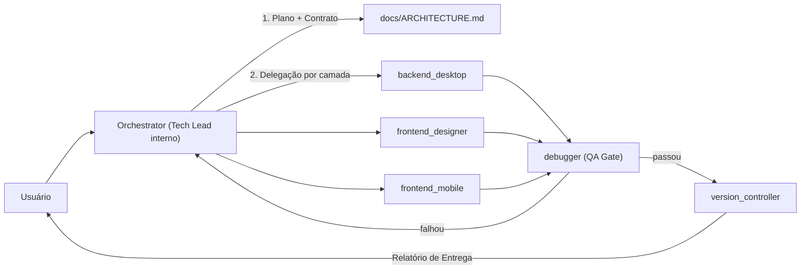

# Plano de Evolução Agêntica — Fase 3 (Refinamento)

## 1. Diagnóstico do modelo atual (Fases 1–2)

| Aspecto | Modelo duplo agêntico (até agora) | Problema na Fase 3 |
| :-- | :-- | :-- |
| Planejamento | Gemini web (PM externo) escrevia o prompt e o Antigravity executava | Cada etapa exigia copiar e colar entre as ferramentas; o contexto do código não chegava ao PM |
| Saída | Todo fim de tarefa gerava `[RELATÓRIO DE SINCRONIZAÇÃO PARA O GEMINI]` | O relatório era feito para outra IA, não para o usuário |
| Bloqueio | "Próximo Passo Bloqueado: aguardando PM/Gemini" | O executor parava mesmo quando a decisão era técnica e óbvia |
| Backend | `src-tauri/` congelado para todos | A Fase 3 exige comandos Rust novos (tray, autostart, import, settings) |
| Personas | 6 arquivos curtos, sem fluxo entre eles | Não havia papel de orquestração, critério de "pronto" nem contrato entre camadas |

## 2. Modelo-alvo: orquestração interna no Antigravity

### Princípios
1. **Um único dono da decisão técnica:** o `orchestrator` decide sozinho tudo o que for técnico. Só leva ao usuário decisões de **produto** (escopo, UX ambígua, custo, dados destrutivos).
2. **Contrato primeiro:** nenhum frontend consome um `invoke`/evento WS que não esteja documentado em `docs/ARCHITECTURE.md`.
3. **Isolamento por camada, não por congelamento:** `src-tauri/` deixa de ser intocável e passa a pertencer **exclusivamente** ao `backend_desktop`.
4. **Gates objetivos:** "pronto" = build + typecheck + `cargo check` verdes + docs atualizadas + commit.
5. **Relatório para o usuário:** o `[RELATÓRIO DE ENTREGA]` substitui o relatório para o Gemini.

## 3. Mudanças nos arquivos

| Arquivo | Ação | Resumo |
| :-- | :-- | :-- |
| `GEMINI.md` | Reescrito | Regras sempre ativas da Fase 3 e novo `[RELATÓRIO DE ENTREGA]` |
| `global_rules.md` | Revisado | Remove o protocolo Gemini, junta os títulos duplicados e adiciona a Definição de Pronto |
| `.agents/README.md` | Reescrito | Índice das personas, pipeline e modos de execução (solo × subagentes) |
| `.agents/orchestrator.md` | **Novo** | Tech Lead/PM interno: intake, plano, contrato, delegação e gate final |
| `.agents/backend_desktop.md` | Reescrito | Dono de `src-tauri/`, padrão de comandos IPC, broadcast e migrações seguras |
| `.agents/frontend_designer.md` | Reescrito | Remove "backend congelado"; consome só contratos documentados; padrão toast/fallback |
| `.agents/frontend_mobile.md` | Reescrito | Dumb client, paridade de tema e checklist Expo |
| `.agents/debugger.md` | Reescrito | Vira QA Gate obrigatório + diagnóstico de causa raiz |
| `.agents/version_controller.md` | Reescrito | Changelog/TODO, commits atômicos e emissão do relatório de entrega |

## 4. Modos de execução

| Modo | Quando usar | Como |
| :-- | :-- | :-- |
| **Solo** | Tarefa em 1 camada e ≤ 3 arquivos | O agente principal assume a persona da camada e executa |
| **Sequencial** | Feature que cruza camadas (Rust → React → Mobile) | Orchestrator define o contrato → backend → frontends → QA |
| **Paralelo** | Frontends independentes depois do contrato fechado | Subagentes `self` por camada; o orchestrator junta o resultado e roda o QA |

> [!TIP]
> Para épicos longos (ex.: todo o backlog da Fase 3), o comando `/goal` mantém o pipeline rodando até a Definição de Pronto. O `/plan` força o plano antes da execução.

## 5. Backlog sugerido da Fase 3 (por épico)

| # | Épico | Camadas | Origem |
| :-- | :-- | :-- | :-- |
| E1 | Persistir configurações de Aparência (cor de destaque, grade, vibração, estilo de ícone) no SQLite `settings` + broadcast | Rust, React, Mobile | Hoje são `useState` locais |
| E2 | Iniciar com o Windows (autostart) e Minimizar para a bandeja (tray) | Rust, React | Fallback "Em breve" |
| E3 | Importar backup JSON (validação + transação SQLite + broadcast) | Rust, React | Fallback "Em breve" |
| E4 | Lista real de dispositivos conectados + desconexão via servidor | Rust, React | Hoje é mock |
| E5 | Toggle ativo/inativo de regra de perfil automático (coluna `enabled`) | Rust, React | Hoje o switch apaga a regra |
| E6 | Integração OBS WebSocket v5 (primeira integração real) | Rust, React | Mock em Integrações |
| E7 | Descoberta mDNS/Zeroconf | Rust, Mobile | TODO aberto |
| E8 | Limpeza técnica: remover `ButtonEditorView.tsx` órfão e fazer code-splitting (bundle > 500 kB) | React | Aviso do Vite |

> [!IMPORTANT]
> A ordem sugerida é E1 → E5 → E3 → E2 → E4 → E8 → E6 → E7: primeiro o que fecha os stubs visíveis, por último as integrações externas.

## 6. Critérios de sucesso da transição
- Nenhum arquivo de regra ou persona menciona "Gemini" como PM nem "aguardando PM".
- Toda entrega termina com `[RELATÓRIO DE ENTREGA]` contendo a evidência dos gates.
- O primeiro épico (E1) é entregue de ponta a ponta sem handoff externo.
